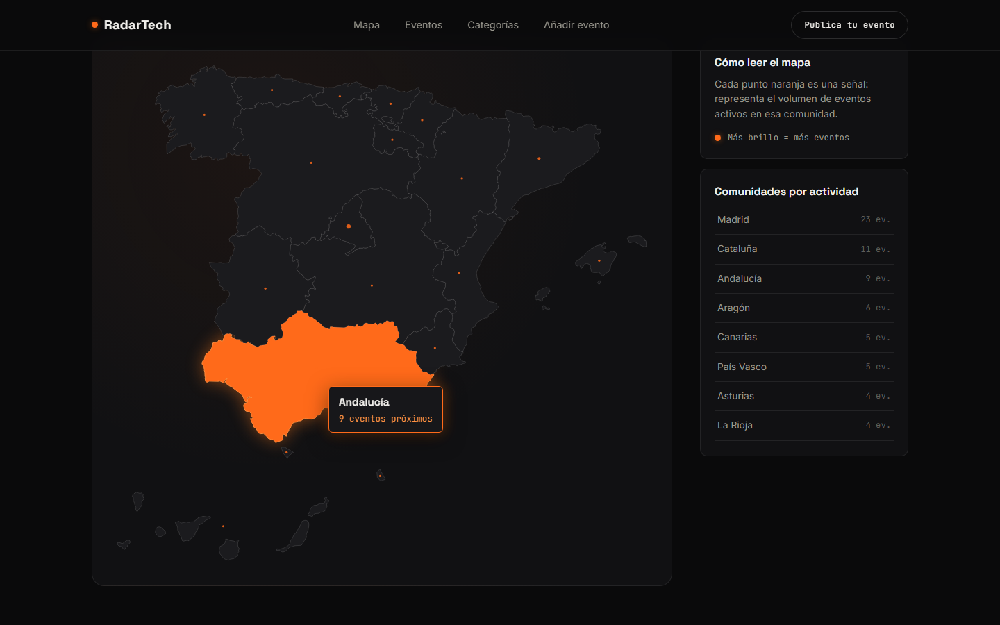
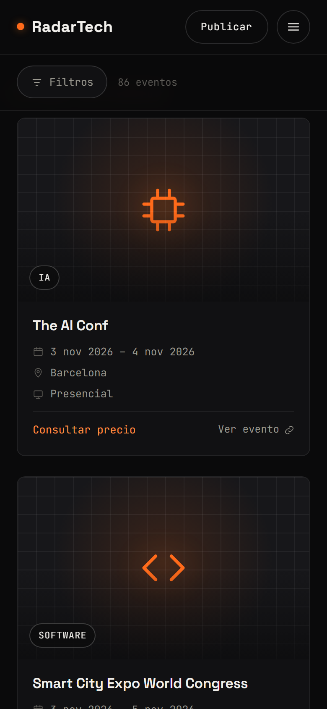
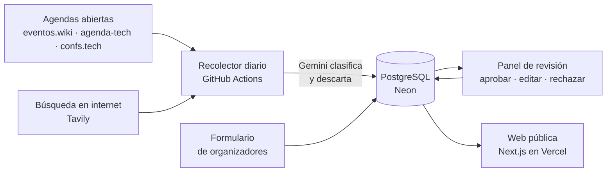

# RadarTech

**Descubre los eventos tecnológicos más relevantes de España.**
*Discover the most relevant tech events in Spain.*

**Web en producción:** [www.radartech.es](https://www.radartech.es) · **Autor:** Brahim Nouni Ros · [LinkedIn](https://www.linkedin.com/in/brahim-nouni-ros-data-ia/)

[](https://github.com/brahimnr2003-beep/radartech/actions/workflows/ci.yml)


-8E75B2?logo=googlegemini&logoColor=white)


<p>
  
  
</p>

[Español](#español) · [English](#english)

---

## Español

### Qué demuestra este proyecto

Web full-stack **en producción, con datos reales y mantenida por IA**, hecha de principio a fin por una sola persona: diseño, desarrollo, base de datos, automatización, pruebas y despliegue.

| Área | Qué se ha hecho |
|---|---|
| **Full-stack con Next.js 16** | App Router, Server Components, Server Actions y Cache Components con TypeScript estricto |
| **Bases de datos** | PostgreSQL en Neon, Drizzle ORM con migraciones versionadas, Docker en local |
| **IA aplicada** | Gemini con salida estructurada validada con Zod para clasificar eventos; búsqueda web con la API de Tavily; revisión humana antes de publicar |
| **Integración de APIs** | APIs REST de terceros: Gemini (vía Vercel AI SDK), Tavily Search, GitHub (OAuth y REST), eventos.wiki y Sentry. Lectura de sitemaps y datos estructurados JSON-LD. Peticiones con timeouts, pausas entre llamadas, User-Agent identificado, validación con Zod de las respuestas de la IA y claves en variables de entorno |
| **Automatización** | Recolector diario en GitHub Actions: lectura de fuentes, deduplicado, clasificación y búsqueda |
| **Testing y CI** | Tests unitarios (Vitest), pruebas e2e (Playwright) y CI con lint, tipos, migraciones, build y e2e en cada push |
| **Autenticación y seguridad** | OAuth con GitHub (Better Auth) restringido al administrador, validación en el servidor y anti-spam sin cuentas |
| **Producción** | Vercel con dominio propio, Sentry con source maps, analítica sin cookies |
| **Frontend y UX** | Mapa SVG interactivo y accesible por teclado, diseño responsive, SEO técnico con datos estructurados |

### Qué es

RadarTech reúne los eventos tecnológicos de España —conferencias, meetups, hackathones y talleres de IA, Data, Software, Cloud, Ciberseguridad y Startups— en un **mapa interactivo por comunidades autónomas**.

Esa información está repartida entre webs de empresas, universidades, asociaciones, plataformas de entradas y redes sociales. RadarTech la junta en un solo sitio, la mantiene al día de forma automática y enlaza siempre a la web oficial de cada evento.

### Funcionalidades

- **Mapa de España** con las 17 comunidades, Ceuta y Melilla: hover con tooltip y número de eventos, navegación por clic o teclado.
- **Listados por comunidad y de toda España**, con los destacados primero y filtros por fecha, comunidad, ubicación, categoría, modalidad, precio y tipo. Los filtros viven en la URL, así que se pueden compartir.
- **Ficha de evento** con cartel, datos, organizador, fuente citada y enlace a la web oficial.
- **Recopilación automática diaria** de agendas abiertas y búsqueda de eventos en internet con IA.
- **Formulario para organizadores** con validación en el servidor y protección anti-spam sin cuentas.
- **Panel de administración** privado (login con GitHub): aprobar, editar, rechazar, destacar y aprobar en bloque, con el motivo que dio la IA para cada evento.
- **Diseño adaptado a móvil**: panel de filtros desde abajo y menú de navegación.

### Cómo funciona



1. Cada mañana un workflow de **GitHub Actions** lee agendas con licencia abierta, elimina duplicados y pide a **Gemini** que decida si cada evento es tecnológico y lo clasifique (categoría, tipo, comunidad y resumen).
2. Después busca eventos en internet con **Tavily**, centrándose en las comunidades con menos actividad, y Gemini extrae los datos de su web oficial. Solo se aceptan eventos con web propia, no fichas de agregadores.
3. Lo que llega de la búsqueda y del formulario entra como **pendiente** y no se publica hasta que lo aprueba una persona.
4. La web solo muestra eventos aprobados y futuros; los pasados desaparecen solos.

### Calidad y buenas prácticas

- **TypeScript estricto** y validación de datos con **Zod** en formularios, importaciones y respuestas de la IA.
- **Tests unitarios** con Vitest y **pruebas de extremo a extremo** con Playwright (mapa, filtros, ficha y formulario).
- **Integración continua**: en cada push, lint, formato, tipos, tests, migraciones sobre una base de datos temporal, build y pruebas e2e.
- **Monitorización de errores** con Sentry (región UE, con source maps y sin datos personales).
- **SEO técnico**: metadatos y URL canónicas, sitemap, datos estructurados `schema.org/Event` e imágenes para compartir generadas en el servidor.
- **Accesibilidad**: mapa manejable con teclado, etiquetas para lectores de pantalla y respeto de `prefers-reduced-motion`.
- **Privacidad**: estadísticas de visitas sin cookies, textos legales y datos alojados en la UE.
- **Coste cero**: todo funciona con planes gratuitos.

### Stack

Next.js 16 (App Router, Cache Components, Server Actions) · React 19 · TypeScript · Tailwind CSS 4 · PostgreSQL (Neon) + Drizzle ORM · Better Auth · Vercel AI SDK + Gemini · Tavily · Zod · Vitest · Playwright · ESLint + Prettier · Sentry · Vercel Web Analytics · GitHub Actions · Vercel.

Las decisiones y sus motivos están en [`contexto/decisiones.md`](contexto/decisiones.md).

### Cómo ejecutarlo en local

Requisitos: Node.js 24 y Docker.

```bash
npm install
cp .env.example .env.local   # rellena las claves que necesites
npm run db:up                # PostgreSQL en Docker (puerto 5433)
npm run db:migrate
npm run db:seed              # eventos de ejemplo (solo en local)
npm run dev                  # http://localhost:3000
```

| Comando | Qué hace |
|---|---|
| `npm test` | Tests unitarios (Vitest) |
| `npm run build && npm run test:e2e` | Pruebas de extremo a extremo (Playwright) |
| `npm run recolectar` | Lee las agendas abiertas y clasifica con Gemini |
| `npm run buscar` | Busca eventos en internet (Tavily + Gemini) |

### Estructura

```
radartech/
├── .github/workflows/  # CI y recolector diario
├── contexto/           # Producto, diseño, hoja de ruta y decisiones
├── docs/boceto/        # Boceto navegable previo al desarrollo (HTML/CSS/JS)
├── drizzle/            # Migraciones de la base de datos
├── e2e/                # Pruebas de Playwright
└── src/
    ├── app/            # Páginas, panel de administración y API (App Router)
    ├── components/     # Interfaz y mapa SVG
    ├── db/             # Esquema y datos de ejemplo
    ├── lib/            # Dominio: eventos, filtros, consultas, SEO
    └── recolector/     # Fuentes, búsqueda con IA, duplicados e importación
```

### Autor

Diseñado y desarrollado por **Brahim Nouni Ros** · [LinkedIn](https://www.linkedin.com/in/brahim-nouni-ros-data-ia/) · [GitHub](https://github.com/brahimnr2003-beep)

---

## English

### What this project shows

A full-stack website **in production, with real data and maintained by AI**, built end to end by one person: design, development, database, automation, testing and deployment.

| Area | What was done |
|---|---|
| **Full-stack with Next.js 16** | App Router, Server Components, Server Actions and Cache Components with strict TypeScript |
| **Databases** | PostgreSQL on Neon, Drizzle ORM with versioned migrations, Docker locally |
| **Applied AI** | Gemini with Zod-validated structured output to classify events; web search with Tavily API; human review before publishing |
| **API integration** | Third-party REST APIs: Gemini (via Vercel AI SDK), Tavily Search, GitHub (OAuth and REST), eventos.wiki and Sentry. Sitemap and JSON-LD structured data parsing. Requests with timeouts, throttling, an identifying User-Agent, Zod-validated AI output and keys kept in environment variables |
| **Automation** | Daily GitHub Actions collector: source reading, deduplication, classification and search |
| **Testing and CI** | Unit tests (Vitest), e2e tests (Playwright) and CI running lint, types, migrations, build and e2e on every push |
| **Auth and security** | GitHub OAuth (Better Auth) restricted to the admin, server-side validation and account-free spam protection |
| **Production** | Vercel with a custom domain, Sentry with source maps, cookie-free analytics |
| **Frontend and UX** | Interactive, keyboard-accessible SVG map, responsive design, technical SEO with structured data |

### What it is

RadarTech gathers Spain's tech events —conferences, meetups, hackathons and workshops on AI, Data, Software, Cloud, Cybersecurity and Startups— on an **interactive map of Spain's autonomous communities**.

That information is scattered across company, university and community websites, ticketing platforms and social media. RadarTech brings it together, keeps it up to date automatically and always links to each event's official website.

### Features

- **Map of Spain** with all 17 regions plus Ceuta and Melilla: hover tooltip with event count, navigation by click or keyboard.
- **Region and nationwide listings**, featured events first, with filters for date, region, location, category, format, price and type. Filters live in the URL, so they can be shared.
- **Event page** with poster, details, organiser, cited source and a link to the official website.
- **Daily automated collection** from open event listings plus AI-powered web search.
- **Submission form** for organisers with server-side validation and account-free spam protection.
- **Private admin panel** (GitHub login): approve, edit, reject, feature and bulk-approve, showing the AI's reasoning for each event.
- **Mobile-friendly design**: bottom-sheet filter panel and navigation menu.

### How it works

See the diagram above. Every morning a **GitHub Actions** workflow reads openly licensed event listings, removes duplicates and asks **Gemini** to decide whether each event is tech-related and classify it. It then searches the web with **Tavily**, focusing on the regions with the fewest events, and only accepts events with their own official website. Everything coming from the search or the form stays **pending** until a human approves it. Past events disappear automatically.

### Quality

- **Strict TypeScript** and **Zod** validation for forms, imports and AI output.
- **Unit tests** (Vitest) and **end-to-end tests** (Playwright).
- **CI** on every push: lint, formatting, types, tests, migrations against a throwaway database, build and e2e tests.
- **Error monitoring** with Sentry (EU region, source maps, no personal data).
- **Technical SEO**: canonical URLs, sitemap, `schema.org/Event` structured data and server-generated social images.
- **Accessibility**: keyboard-operable map, screen-reader labels and `prefers-reduced-motion` support.
- **Privacy**: cookie-free analytics, legal pages and EU data hosting.
- **Zero cost**: runs entirely on free plans.

### Stack

Next.js 16 (App Router, Cache Components, Server Actions) · React 19 · TypeScript · Tailwind CSS 4 · PostgreSQL (Neon) + Drizzle ORM · Better Auth · Vercel AI SDK + Gemini · Tavily · Zod · Vitest · Playwright · ESLint + Prettier · Sentry · Vercel Web Analytics · GitHub Actions · Vercel.

### Running locally

Requirements: Node.js 24 and Docker. See the commands in the [Spanish section](#cómo-ejecutarlo-en-local).

### Author

Designed and built by **Brahim Nouni Ros** · [LinkedIn](https://www.linkedin.com/in/brahim-nouni-ros-data-ia/) · [GitHub](https://github.com/brahimnr2003-beep)

---

© 2026 RadarTech. Todos los derechos reservados / All rights reserved.
